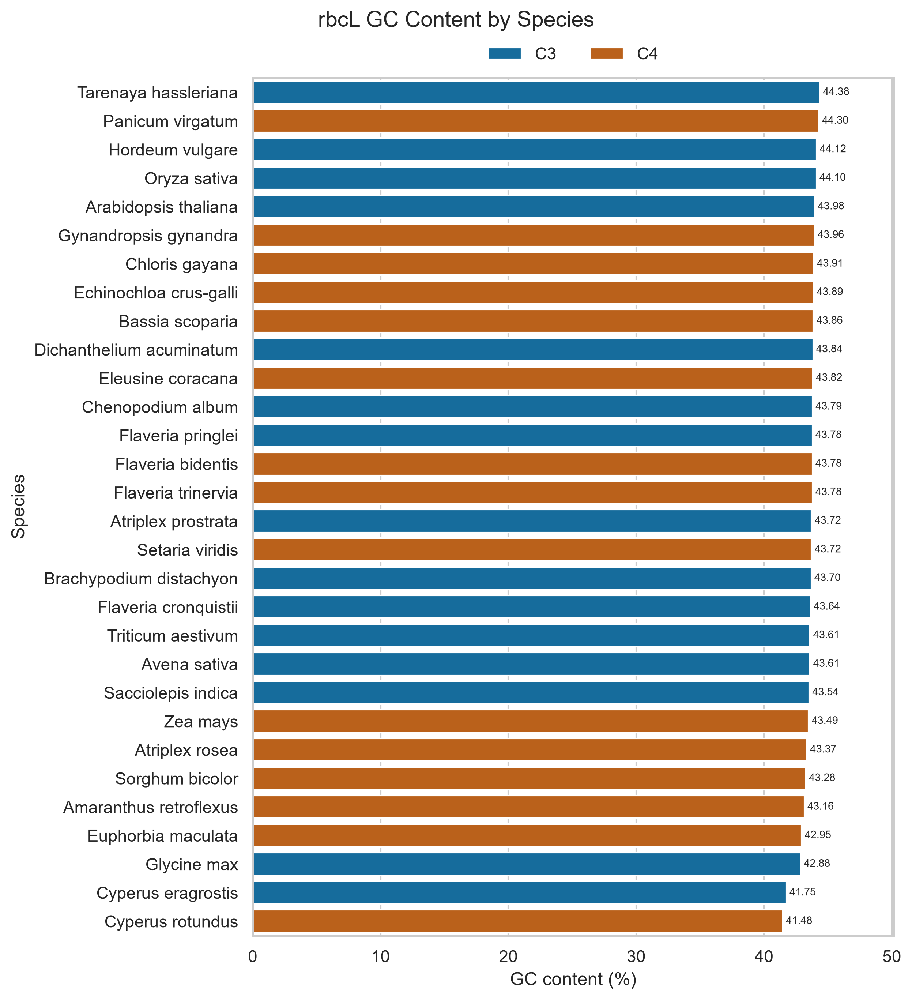
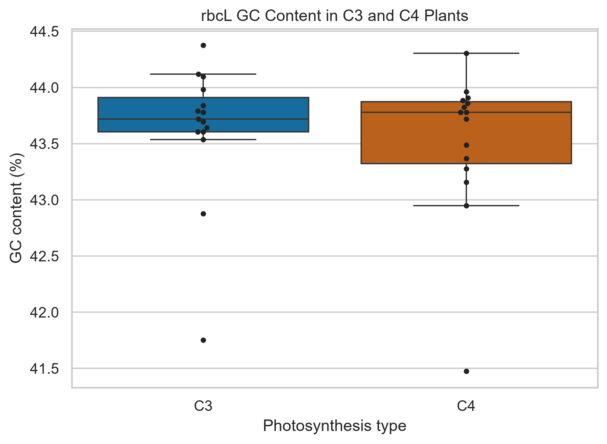
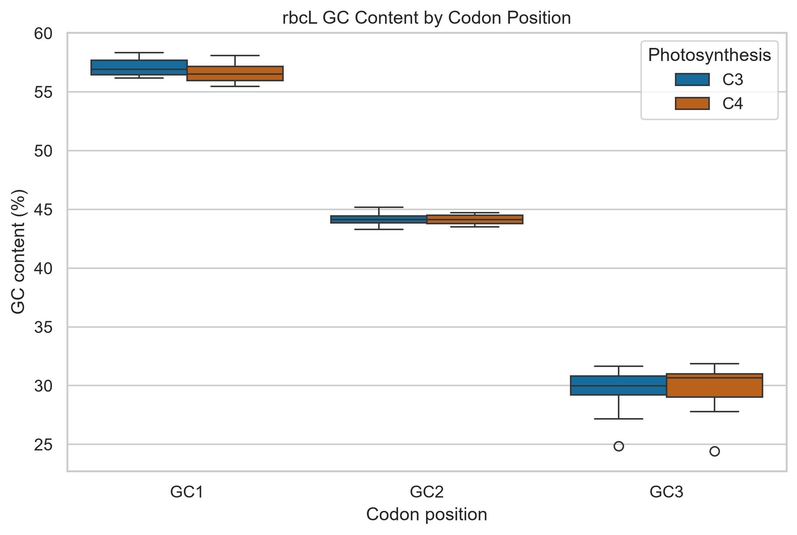
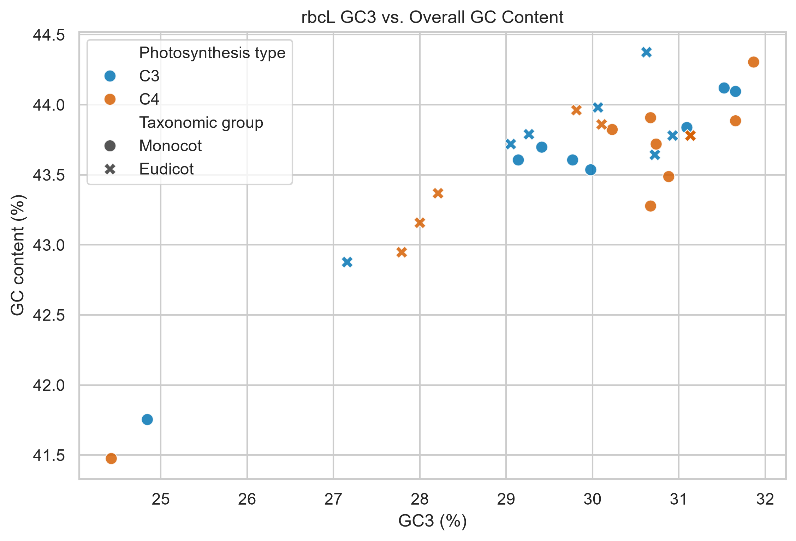

# 12주차 · 서열 수집과 GC 함량

## 목표와 수집 절차

NCBI의 rbcL CDS와 GenBank 주석 번역을 대조하고, 같은 계산 기준으로 30종의 염기 조성을 비교했습니다. Windows의 독립 `rbcL` 환경에서 Biopython 1.88, Pandas 3.1.1, Matplotlib 3.11.2와 Seaborn 0.13.2를 사용했습니다.

| 시험 수집 종 | 그룹 | 확인한 NCBI nucleotide accession |
| --- | --- | --- |
| *Oryza sativa* | C3 외떡잎식물 | [NC_001320.1](https://www.ncbi.nlm.nih.gov/nuccore/NC_001320.1) |
| *Flaveria pringlei* | C3 진정쌍떡잎식물 | [HQ534133.1](https://www.ncbi.nlm.nih.gov/nuccore/HQ534133.1) |
| *Zea mays* | C4 외떡잎식물 | [NC_001666.2](https://www.ncbi.nlm.nih.gov/nuccore/NC_001666.2) |
| *Flaveria bidentis* | C4 진정쌍떡잎식물 | [MK836182.1](https://www.ncbi.nlm.nih.gov/nuccore/MK836182.1) |

시험 수집 네 종이 모두 검증을 통과한 뒤 전체 수집을 실행했습니다. 완전 엽록체 RefSeq, 완전 엽록체 GenBank, 완전한 독립 rbcL CDS 순으로 검색했고 같은 단계에서 NCBI가 반환한 순서의 첫 검증 통과 레코드를 선정했습니다. GenBank source의 학명과 taxonomy ID, CDS 위치와 방향, 염기 모호성, 3의 배수, 시작·종결과 내부 stop, 주석 번역 일치 여부를 검증했습니다.

### 초도 수집에서 재검토한 종

| 초도 후보 | 최종 결정과 근거 |
| --- | --- |
| *Dichanthelium oligosanthes* | 적합한 NCBI GenBank CDS를 확보하지 못해 같은 속의 C3인 *D. acuminatum*으로 교체. [C3 분류 근거](https://pmc.ncbi.nlm.nih.gov/articles/PMC8801178/) · [NC_030623.1](https://www.ncbi.nlm.nih.gov/nuccore/NC_030623.1) |
| *Flaveria robusta* | 적합한 NCBI GenBank CDS를 확보하지 못해 같은 속의 C3인 *F. cronquistii*로 교체. [C3 분류 근거](https://doi.org/10.3732/ajb.94.3.382) · [HQ534139.1](https://www.ncbi.nlm.nih.gov/nuccore/HQ534139.1) |
| *Chloris gayana* | 독립 CDS [AM849409.1](https://www.ncbi.nlm.nih.gov/nuccore/AM849409.1)의 불완전 좌표 때문에 제외한 뒤, 표제가 `genome assembly, organelle`인 원형 엽록체 유전체 [OZ205796.1](https://www.ncbi.nlm.nih.gov/nuccore/OZ205796.1)을 찾아 원래 종을 유지. 대체 후보로 확인한 *C. virgata*는 최종 집계에서 빠짐 |
| *Atriplex rosea* | 같은 종을 유지. 독립 GenBank [X55831.1](https://www.ncbi.nlm.nih.gov/nuccore/X55831.1)은 CDS에 `gene` 태그가 생략되어 있어 표제의 rbcL, 유일한 CDS의 Rubisco 큰 소단위체 주석, 완전한 좌표, 공식 번역 및 versioned protein ID를 함께 대조 |

엽록체 유전체에서는 `gene=rbcL` CDS를 추출했습니다. 구형 주석에 대한 제목·산물 대조 기준은 독립 rbcL 레코드에만 적용했습니다. 첫 수집에서 사용한 후보와 제외 사유는 [초도 로그](results/initial_collection_log.txt)와 [초도 제외표](results/initial_exclusions.csv)에 있습니다. 다음 수집에서 엽록체 조립 레코드가 검색에서 빠진 원인은 [중간 수집 로그](results/failed_collection/download_log.txt)와 최종 수집 로그에서 비교할 수 있습니다.

## 계산 기준과 재실행

CDS 길이와 A/T/G/C 원시 개수는 **종결 코돈을 포함**합니다. AT 및 전체 GC 백분율은 **검증된 마지막 종결 코돈 세 염기를 뺀** CDS의 전체 염기 수를 분모로 사용합니다. GC1, GC2, GC3의 분모는 같은 서열에서 각 위치의 염기 수이며 각 값은 해당 코돈 위치의 G와 C 개수를 합해 계산합니다.

프로젝트 루트의 Anaconda PowerShell에서 환경을 활성화한 후 실행합니다. NCBI 연락처는 실행 환경의 `NCBI_EMAIL`에서 읽습니다. 보관된 데이터에서 분석만 재현할 때는 `python -m scripts.week12_gc`를 실행합니다.

```powershell
conda activate rbcL
python -m scripts.week12_collect --phase pilot
python -m scripts.week12_collect --phase all
python -m scripts.week12_gc
python -m unittest discover -s tests -v
```

[NCBI 수집 코드](../scripts/week12_collect.py) · [GC 분석 코드](../scripts/week12_gc.py) · [테스트 및 재현 결과](test_results.md)

## 결과

2026-11-24에 수집한 최종 30종 모두 CDS 검증을 통과했습니다. 완전 RefSeq 엽록체 유전체에서 22종, 완전 GenBank 엽록체 유전체에서 4종, 독립 GenBank rbcL CDS에서 4종을 확보했습니다. CDS는 1,428–1,458 nt였고 전체 GC 범위는 41.48–44.38%였습니다.

| 비교 그룹 | 종 수 | 전체 GC 평균 | GC1 평균 | GC2 평균 | GC3 평균 |
| --- | ---: | ---: | ---: | ---: | ---: |
| C3 | 15 | 43.63% | 57.08% | 44.12% | 29.68% |
| C4 | 15 | 43.52% | 56.59% | 44.13% | 29.82% |
| 외떡잎식물 | 16 | 43.51% | 56.27% | 44.35% | 29.91% |
| 진정쌍떡잎식물 | 14 | 43.64% | 57.49% | 43.87% | 29.57% |
| C3 외떡잎식물 | 8 | 43.53% | 56.55% | 44.37% | 29.68% |
| C4 외떡잎식물 | 8 | 43.49% | 55.98% | 44.33% | 30.14% |
| C3 진정쌍떡잎식물 | 7 | 43.74% | 57.70% | 43.83% | 29.69% |
| C4 진정쌍떡잎식물 | 7 | 43.55% | 57.29% | 43.90% | 29.46% |

C4의 전체 GC 평균은 C3보다 0.11%p 낮았고 GC3 평균은 0.14%p 높았습니다. 외떡잎식물에서는 C4의 GC3 평균이 0.47%p 높았지만 진정쌍떡잎식물에서는 0.23%p 낮았습니다. GC3은 두 광합성 유형에서 세 코돈 위치 중 평균이 가장 낮았습니다.

최종 표본과 개별 accession은 [종 메타데이터](../data/processed/species_metadata.csv), 레코드별 주석과 방향은 [서열 검증표](../data/processed/sequence_validation.csv)에 있습니다. [CDS FASTA](../data/processed/rbcL_nucleotide.fasta), [단백질 FASTA](../data/processed/rbcL_protein.fasta), [최종 다운로드 로그](../data/processed/download_log.txt), [시험 수집 결과](results/pilot/sequence_validation.csv), [원본 GenBank](../data/raw/)를 함께 보관했습니다. 종별 개수와 백분율은 [종별 결과](results/species_gc.csv), 그룹별 표본 수·평균·표준편차는 [그룹별 결과](results/group_gc_summary.csv)에 있습니다.

## 그래프









## 해석의 범위와 다음 주차

GC3은 전체 GC를 구성하는 세 값 중 하나입니다. 같은 분모 구조 때문에 전체 GC는 GC1, GC2, GC3의 산술평균이므로 산점도의 관계 일부는 계산 정의에서 생깁니다. 단일 엽록체 유전자와 종당 대표 서열 한 개를 사용했고 가까운 종은 공통조상을 공유합니다. *F. pringlei*는 문헌의 기능적 C3 분류를 적용했습니다. proto-Kranz 해부 형태가 보고된 점은 [참고문헌](references.md)에 기록했습니다. 그룹 차이의 통계적 검정은 15주차에 다룹니다.

13주차에서는 검증된 CDS·단백질 FASTA를 바탕으로 아미노산 조성과 코돈 사용을 비교합니다. [학생 학습 기록](learning_log.md) · [AI 협업 기록](ai_usage_log.md)
