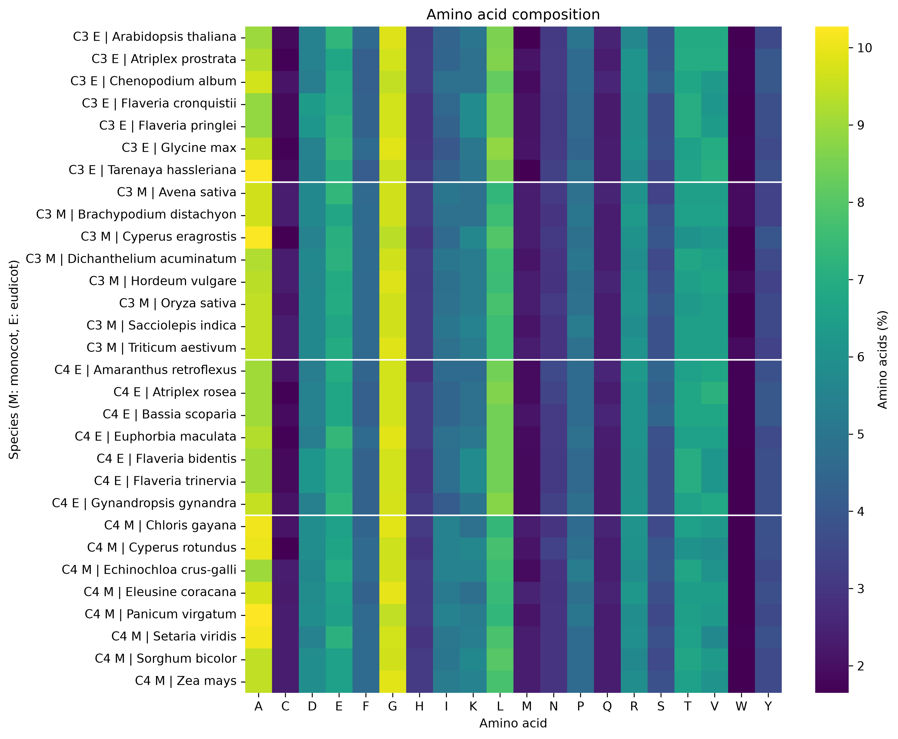
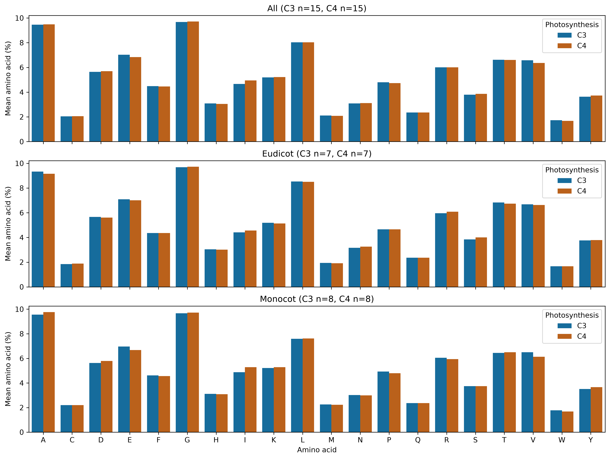
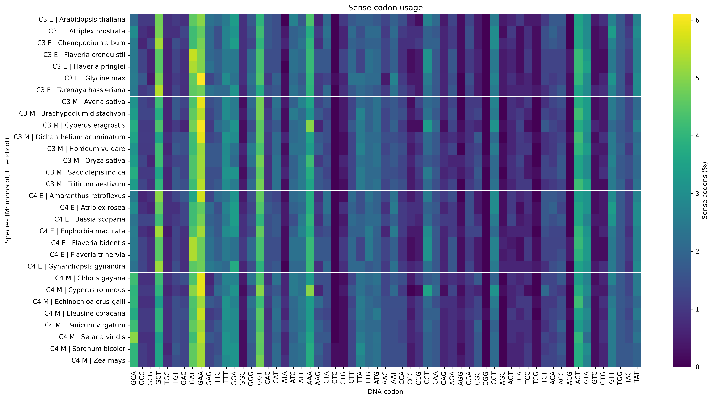
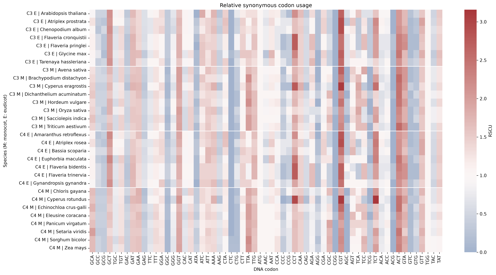
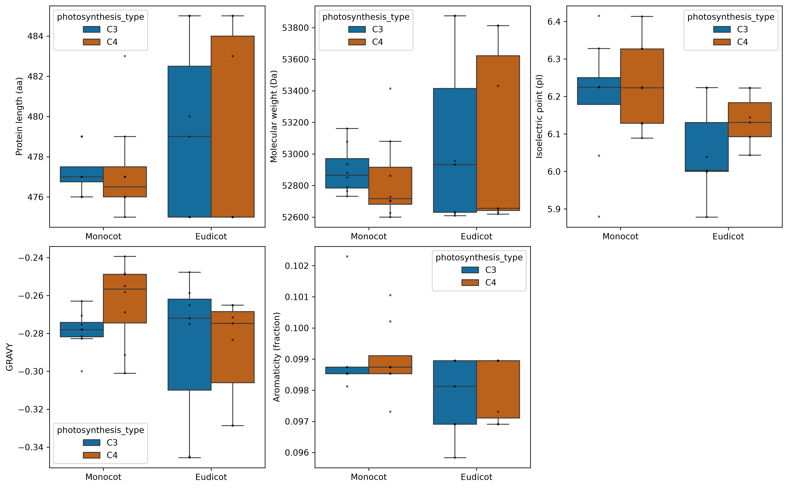

# 13주차 · 코돈 사용과 아미노산 조성

12주차에 검증한 30종을 대상으로 엽록체 rbcL의 코돈 사용과 Rubisco 큰 소단위체의 아미노산 조성 및 서열 기반 특성을 비교했습니다. C3와 C4는 각각 외떡잎식물 8종과 진정쌍떡잎식물 7종으로 구성됩니다.

## 입력과 계산 방법

[CDS FASTA](../data/processed/rbcL_nucleotide.fasta), [단백질 FASTA](../data/processed/rbcL_protein.fasta), [종 메타데이터](../data/processed/species_metadata.csv), [서열 검증표](../data/processed/sequence_validation.csv)를 종 ID로 연결했습니다. 검증표의 번역표를 사용해 CDS를 다시 번역했고, 30종 모두 저장된 단백질과 일치했습니다. 실제 적용된 번역표는 모두 NCBI table 11이고 시작 코돈은 모두 ATG였습니다. 입력 레코드 30개를 모두 분석에 포함했습니다. [NCBI 유전 암호표](https://www.ncbi.nlm.nih.gov/Taxonomy/Utils/wprintgc.cgi#SG11)

- 표준 아미노산 20개의 개수를 세고, 종별 단백질 길이로 나눠 백분율을 계산했습니다. 분자량은 평균 동위원소 질량 기준의 Da로 기록했습니다. pI는 등전점 추정값, GRAVY는 평균 소수성 점수, aromaticity는 F·W·Y의 합계 비율(0–1)입니다. [Biopython ProteinAnalysis](https://biopython.org/docs/1.88/api/Bio.SeqUtils.ProtParam.html)
- 코돈 빈도는 종결 코돈을 제외한 의미 코돈 수를 분모로 계산했습니다. 코돈 열은 DNA 표기(T)를 사용합니다. 시작 위치의 DNA 코돈은 그대로 세고, 단백질 번역에는 시작 코돈 규칙을 적용합니다.
- RSCU는 특정 코돈의 관측 횟수를 그 아미노산의 동의 코돈이 균등하게 쓰일 때의 기대 횟수로 나눈 값입니다. 동의 코돈군이 관측됐으면 사용되지 않은 코돈의 RSCU는 0입니다. 코돈군 전체가 관측되지 않으면 빈칸으로 기록합니다. 실제 30종 자료에는 RSCU 결측값이 없었습니다. [Sharp 등, 1986](https://pmc.ncbi.nlm.nih.gov/articles/PMC311530/)
- 그룹 요약표에는 C3·C4 전체와 분류군별 결과를 함께 담았습니다. 각 종에 같은 가중치를 주고, 지표별 전체 표본 수, 유효 표본 수, 평균, 표본 표준편차를 기록했습니다.

## 결과

아미노산 20개 중 종별 백분율의 전체 평균이 가장 높은 항목은 글라이신(G, 9.70%), 알라닌(A, 9.47%), 류신(L, 8.03%)이었습니다. C3와 C4 평균 차이가 가장 큰 아미노산은 아이소류신(I)이었습니다. C4의 비율은 C3보다 전체에서 0.29%p, 외떡잎식물에서 0.42%p, 진정쌍떡잎식물에서 0.15%p 높았습니다.

30종에서 평균 빈도가 가장 높은 코돈은 GAA(5.27%)였습니다. C4의 GCA 빈도는 전체에서 C3보다 0.38%p 높았고, 외떡잎식물에서는 0.71%p 높았습니다. 진정쌍떡잎식물에서는 ATT의 평균 빈도 차이가 가장 컸습니다(C4가 0.36%p 높음). 전체 평균 RSCU가 가장 높은 코돈은 아르기닌의 CGT(2.48)였습니다. GAA 빈도는 전체 의미 코돈에서 차지하는 비율이고, CGT의 RSCU는 아르기닌 동의 코돈군의 균등 기대치에 대한 비율입니다.

| 광합성 유형 | 종 수 | 평균 분자량 (kDa) | 평균 pI | 평균 GRAVY | 평균 aromaticity |
| --- | ---: | ---: | ---: | ---: | ---: |
| C3 | 15 | 52.980 | 6.129 | −0.283 | 0.09844 |
| C4 | 15 | 52.955 | 6.187 | −0.275 | 0.09858 |

단백질 길이는 475–485개 아미노산이었습니다. GRAVY는 전 종에서 음수로, 서열 전체의 평균 소수성 점수가 음수인 범위에 있었습니다. 네 그룹을 구성하는 종은 계통적으로 서로 관련되어 있으므로 표에서 보이는 차이는 이 표본의 기술통계로 해석합니다. 전장 조성으로 특정 잔기의 위치나 Rubisco의 효소 활성을 추정하는 데에는 한계가 있습니다. [연구 계획과 해석 기준](../week11/research_plan.md)

## 표와 그림

- [종별 아미노산 개수·백분율](results/species_amino_acid_composition.csv) · [종별 단백질 특성](results/species_protein_properties.csv)
- [종별 코돈 개수·빈도](results/species_codon_frequency.csv) · [종별 RSCU](results/species_rscu.csv) · [그룹 요약](results/group_composition_summary.csv)











## 재현

프로젝트 루트의 Anaconda PowerShell에서 아래 명령을 실행합니다. Python 3.13.18, Biopython 1.88, Pandas 3.1.1, NumPy 2.5.5, Matplotlib 3.11.2, Seaborn 0.13.2 환경에서 실행했습니다. PNG 검증에는 Pillow 13.0.0을 사용했습니다.

```powershell
conda activate rbcL
python -m scripts.week13_composition
python -m unittest discover -s tests -v
```

[분석 코드](../scripts/week13_composition.py) · [테스트 기록](test_results.md) · [학습 기록](learning_log.md) · [AI 협업 기록](ai_usage_log.md) · [참고문헌](references.md)

14주차에는 단백질 서열을 정렬하고, 참조 잔기 번호를 대응시켜 149번과 309번을 비교합니다. 코돈 정렬을 바탕으로 rbcL 유전자 계통수를 작성합니다.
